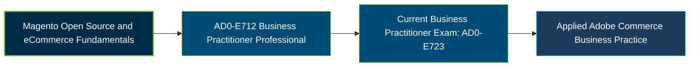

# Adobe Commerce Business Practitioner Professional Certification Exam Guide

A dedicated, comprehensive study guide and business reference repository for candidates preparing for the **Adobe Commerce Business Practitioner Professional Certification Exam (AD0-E712)**.

---

## Exam Overview

The Adobe AD0-E712 certification validates business-level knowledge of Magento Open Source and Adobe Commerce, including catalog management, commerce operations, digital marketing, and security fundamentals. Adobe's current Business Practitioner Professional listing uses exam code AD0-E723, so candidates should verify AD0-E712 availability before scheduling.

- **Exam Format**: Online proctored examination; confirm availability and delivery details for AD0-E712 in the Adobe Certification Portal.
- **Target Audience**: Business Analysts, Project Managers, Product Owners, Consultants, eCommerce Managers, and Adobe Commerce Strategists.
- **Prerequisites**: No formal prerequisite stated in the AD0-E712 preparation guide; foundational Adobe Commerce and eCommerce knowledge is recommended.

---

## Core Exam Domains & Knowledge Areas

### 1. Magento Open Source Core Features

- Identify Magento Open Source features, scope, and standard storefront functionality.
- Demonstrate knowledge of catalog management, product pricing, and customer journeys.
- Explain order lifecycle, store maintenance, and content elements.

### 2. Adobe Commerce Basics

- Identify key features and capabilities available in Adobe Commerce.
- Understand Adobe Commerce service add-ons and integrations.
- Identify hosting options and distinguish Commerce platform offerings.

### 3. Digital Marketing and eCommerce Fundamentals

- Understand digital marketing tools, analytics, email marketing, and customer segmentation.
- Explain SEO principles and common eCommerce tools such as shopping feeds.
- Identify essential eCommerce website features and storefront concepts.

### 4. Compliance and Security Basics

- Understand privacy requirements and payment security fundamentals.
- Identify common security considerations for Adobe Commerce projects.
- Recognize accessibility practices and relevant legal requirements.

---

## Certification Path

The following diagram represents a suggested learning progression. It is not an official Adobe certification pathway.

---

## Recommended Practice & Study Resources

To prepare effectively, combine Adobe's official certification materials with Commerce documentation and objective-based practice:

- **CertsGate**: Explore [Adobe AD0-E712 study materials and practice resources](https://certsgate.com/exams/adobe/ad0-e712) to review concepts, assess your knowledge, and identify areas for further preparation.
- **Adobe Commerce Documentation**: Use the [Adobe Commerce User Guide](https://experienceleague.adobe.com/en/docs/commerce-admin/user-guides/home) to explore catalog management, store configuration, customer experience, orders, and commerce operations.
